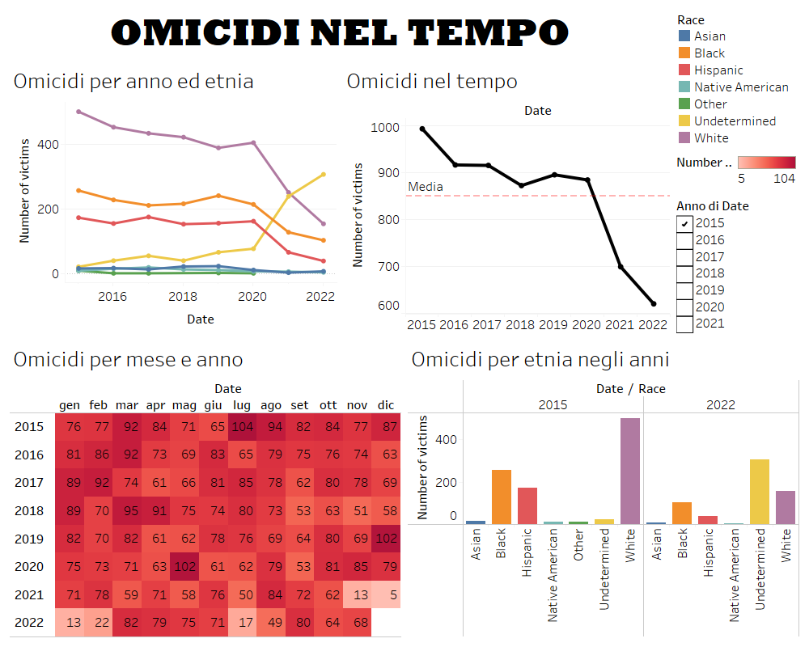

# Analisi esplorativa e reporting

Progetto accademico sulle sparatorie mortali da parte della polizia negli Stati Uniti tra il 2015 e il 2022. L’analisi confronta variabili demografiche, comportamentali e geografiche. Il lavoro di data mining esplora raggruppamenti e regole di associazione.

[Dashboard 2](dashboard/dashboard-2.png) · [Dashboard 3](dashboard/dashboard-3.png) · [Dashboard 4](dashboard/dashboard-4.png)

- [Preprocessing in Python](preprocessing.ipynb)
- [Notebook di data mining](data-mining.ipynb)
- [Cartella di lavoro Tableau](analisi-visuale.twb)

Il notebook di preprocessing legge un file locale \`dataset.csv\` e produce \`cleaned_dataset.csv\`. Per aprire la cartella di lavoro in Tableau, ricollega \`cleaned_dataset.csv\` come origine dati se richiesto. Le anteprime sono consultabili direttamente da GitHub. I CSV originali non sono inclusi.
